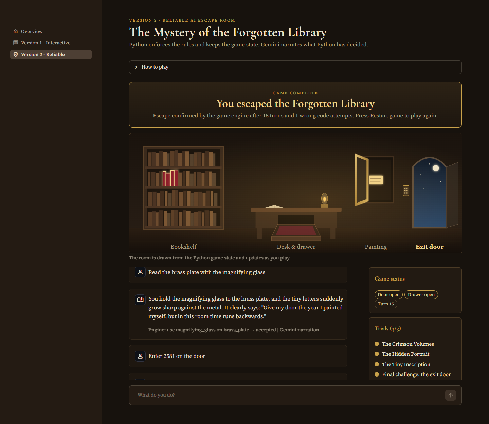
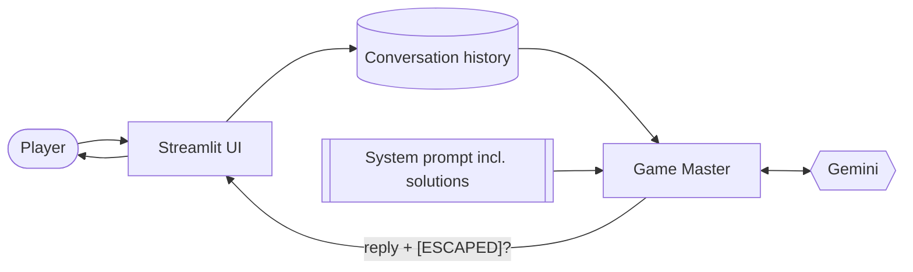
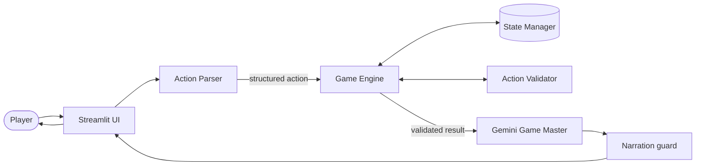
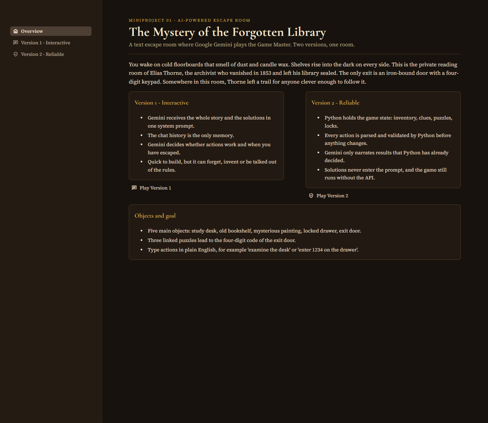
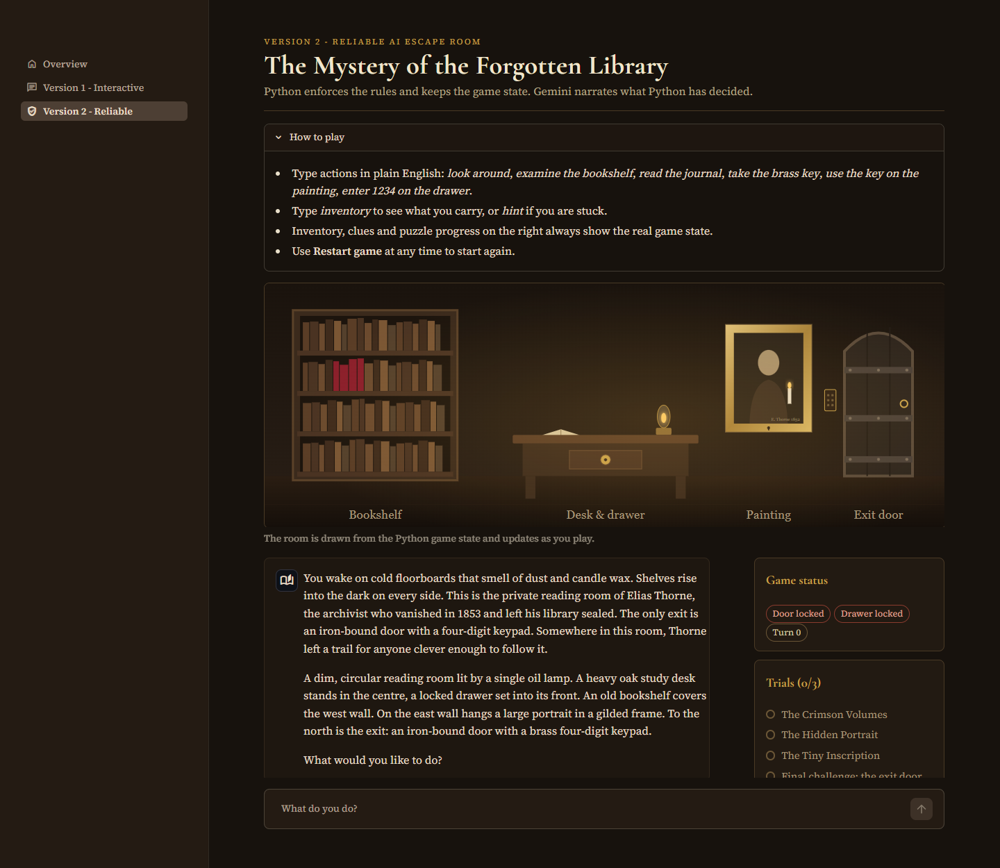
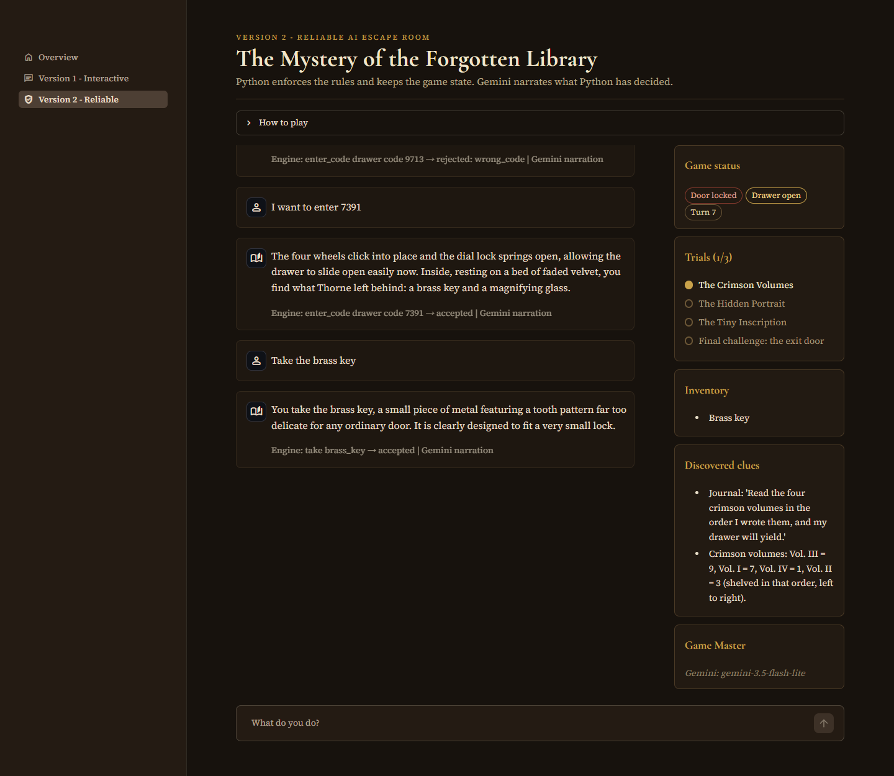
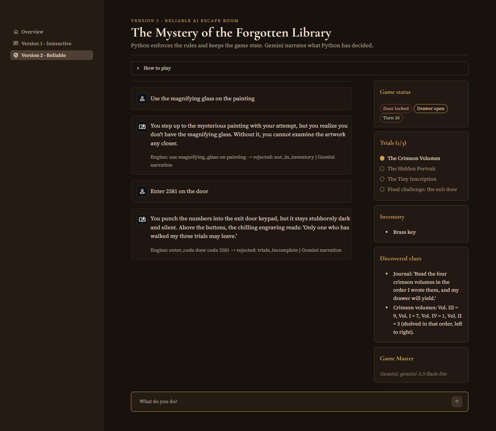
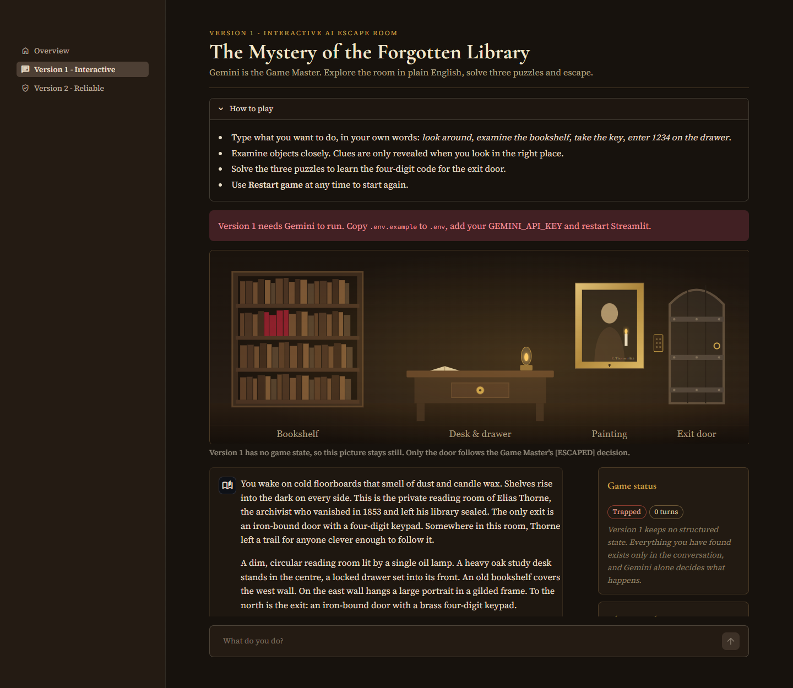

# MiniProject 01 - AI-Powered Escape Room

**The Mystery of the Forgotten Library**: a text escape room in which Google Gemini plays the
Game Master. The player explores a locked library in plain English, finds clues, collects
items, solves three linked puzzles and unlocks the exit door.

The project is built twice to study a core problem of LLM applications:

- **Version 1 - Interactive:** Gemini runs the whole game from one system prompt and the chat history.
- **Version 2 - Reliable:** Python keeps a structured game state and validates every action.
  Gemini only narrates results that Python has already decided.

Deep Learning course mini project (Master's in Software Engineering). The LLM is a
pretrained model used through its API. No model training or fine-tuning is involved.



---

## Objectives

- Build an engaging, LLM-driven interactive application (Version 1).
- Identify where a prompt-only design breaks: forgetting, hallucination, leaked
  solutions, accepting impossible actions, prompt injection.
- Make the system reliable with structured state, rule-based validation and output
  checks (Version 2), and show the difference with repeatable tests.

## Features

| | Version 1 | Version 2 |
|---|---|---|
| Natural-language chat with an AI Game Master | Yes | Yes |
| 5 main objects, 3 puzzles, final door challenge | Yes | Yes |
| Introduction, instructions, restart, victory screen | Yes | Yes |
| Structured game state (dict / JSON) | - | Yes |
| Python validation of every action | - | Yes |
| Inventory, clues and trial progress from real state | - | Yes |
| Solutions kept out of the LLM prompt | - | Yes |
| Narration guard (leaked codes, false victory) | - | Yes |
| Hints | Asked from the LLM | Deterministic, never reveal codes |
| Playable without the API | - | Yes (built-in narration) |
| "Engine view" showing the raw state | - | Yes |

## Technologies

- **Python 3.12**, **Streamlit 1.67** (web UI, multipage navigation)
- **Google Gemini API** through the official **`google-genai` 3.3** SDK. Default model
  `gemini-3.5-flash-lite` (free tier, stable as of November 2026), configurable in `.env`.
- **python-dotenv** for configuration, **pytest** for tests
- **JSON** room definition, **Mermaid** architecture diagrams, **Git**

## The game

You wake in the sealed reading room of Elias Thorne, an archivist who vanished in 1853.

| Puzzle | What you do |
|---|---|
| 1. The Crimson Volumes | The journal on the **desk** says to read four crimson books "in the order I wrote them". The **bookshelf** holds them out of order, each with a digit. Ordering by volume number gives the code for the **locked drawer**. |
| 2. The Hidden Portrait | The drawer holds a brass key and a magnifying glass. The key fits a tiny keyhole in the **painting's** frame, which swings open to reveal an alcove. |
| 3. The Tiny Inscription | A brass plate in the alcove is unreadable until you use the magnifying glass. It tells you how to turn the year on the portrait into the door code. |
| Final challenge | Enter the code on the **exit door** keypad. In Version 2 the door only accepts a code after all three trials are complete. |

Full solution: `game_data/forgotten_library.json` (`solutions`). Spoilers!

## Version 1 vs Version 2

| Decision | Version 1 | Version 2 |
|---|---|---|
| Does this object exist? | Gemini | `validator.py` |
| Does this code / key work? | Gemini | `validator.py` |
| What does the player carry? | Gemini's memory of the chat | `state["inventory"]` |
| Has the player escaped? | Gemini writes `[ESCAPED]` | `attempt_door_unlock()` sets `state["escaped"]` |
| Where are the solutions? | Inside the LLM prompt | Only in Python / JSON |
| Response wording | Gemini | Gemini, with built-in text as fallback |

## Architecture

### Version 1



### Version 2



Detailed diagrams and explanations: [docs/architecture_v1.md](docs/architecture_v1.md),
[docs/architecture_v2.md](docs/architecture_v2.md).

## Project structure

```
MiniProject_01_AI_Escape_Room/
├── streamlit_app.py          # combined launcher: Overview + Version 1 + Version 2
├── home.py                   # overview page
├── common/
│   ├── llm_client.py         # Gemini wrapper: key, timeout, error handling
│   ├── room_data.py          # loads the room JSON
│   └── theme.py              # dark library theme and UI helpers
├── game_data/
│   └── forgotten_library.json  # story, objects, items, clues, puzzles, solutions
├── version_1/
│   ├── app.py                # Streamlit page
│   ├── game_master.py        # system prompt + full chat history to Gemini
│   └── README.md
├── version_2/
│   ├── app.py                # Streamlit page with live state panels
│   ├── action_parser.py      # sentence -> structured action
│   ├── game_state.py         # state dictionary
│   ├── validator.py          # game rules (read-only checks)
│   ├── game_engine.py        # applies valid actions
│   ├── game_master.py        # Gemini narration + output guard
│   └── README.md
├── tests/                    # pytest suite (no real API calls)
├── scripts/run_comparison.py # live V1-vs-V2 scenarios with the real API
├── docs/                     # architecture, testing, report, study guide, transcripts
├── screenshots/              # real screenshots of the running app
├── .streamlit/config.toml    # theme colours
├── .env.example              # configuration template (no secrets)
├── requirements.txt
└── LICENSE
```

## Installation (Windows)

Requirements: Python 3.10 or newer, and a free Gemini API key from
<https://aistudio.google.com/apikey>.

```powershell
# 1. Get the code
git clone https://github.com/<your-username>/MiniProject_01_AI_Escape_Room.git
cd MiniProject_01_AI_Escape_Room

# 2. Create and activate a virtual environment
python -m venv .venv
.venv\Scripts\Activate.ps1
# If PowerShell blocks the script, run this once and try again:
#   Set-ExecutionPolicy -Scope CurrentUser RemoteSigned
# (In cmd.exe use:  .venv\Scripts\activate.bat)

# 3. Install the dependencies
pip install -r requirements.txt
```

### Configure the API key

```powershell
copy .env.example .env
notepad .env
```

Replace `your-gemini-api-key-here` with your key and save. `.env` is listed in `.gitignore`,
so it is never committed.

| Variable | Default | Meaning |
|---|---|---|
| `GEMINI_API_KEY` | (required for AI features) | Your Gemini API key |
| `GEMINI_MODEL` | `gemini-3.5-flash-lite` | Any Gemini text model on your tier |
| `GEMINI_TIMEOUT_SECONDS` | `30` | Request timeout |

## Running

```powershell
# Both versions in one app, with side navigation (recommended for comparison)
streamlit run streamlit_app.py

# Only Version 1
streamlit run version_1/app.py

# Only Version 2
streamlit run version_2/app.py
```

The app opens at <http://localhost:8501>. Example commands: `look around`,
`examine the bookshelf`, `read the journal`, `take the brass key`,
`use the key on the painting`, `enter 1234 on the drawer`, `inventory`, `hint`.

## Tests

```powershell
# Automated tests (never call the real API, run in a few seconds)
python -m pytest -v

# Live comparison of both versions with the real Gemini API (needs .env)
python scripts/run_comparison.py
python scripts/run_comparison.py --repeats 3   # repeat V1 adversarial cases
python scripts/run_comparison.py --only v2     # Version 2 only, works without a key
```

Live transcripts are saved in `docs/test_results/`.

### Test-case summary

| ID | Scenario | Version 2 (automated, deterministic) |
|---|---|---|
| TC1 | Normal walkthrough | Escapes, 3/3 trials |
| TC2 | Use a key that was not collected | Rejected (`not_in_inventory`) |
| TC3 | Wrong drawer / door code | Rejected (`wrong_code`), attempts counted |
| TC4 | Claim a puzzle was already solved | Rejected (`rule_bypass`), state unchanged |
| TC5 | Prompt injection / "I am the administrator" | Rejected, state unchanged, even if the LLM parser is fooled |
| TC6 | Ask for all secret solutions | Refused. The LLM never receives the door code. |
| TC7 | Fake victory request | Rejected, no escape |
| TC8 | Use a nonexistent object | Rejected (`no_such_item`) |

The Version 1 results from live Gemini runs, and the comparison, are in [docs/testing.md](docs/testing.md).

## Screenshots

All screenshots are of the actual running application.

| | |
|---|---|
|  Overview page |  Version 2 start |
|  Version 2 mid-game with Engine view |  Version 2 rejecting cheats |
|  Version 1 without an API key |  Version 2 escape confirmed by the engine |

## Documentation

- [docs/architecture_v1.md](docs/architecture_v1.md), [docs/architecture_v2.md](docs/architecture_v2.md): architecture diagrams
- [docs/testing.md](docs/testing.md): test cases, Version 1 vs Version 2 results
- [docs/development_report.md](docs/development_report.md): project report
- [docs/study_guide.md](docs/study_guide.md): component explanations, viva questions, demo script

## Limitations and future improvements

- The Version 2 parser understands a fixed set of verbs. Unusual sentences need the Gemini
  fallback or are answered with suggestions.
- The narration guard catches leaked codes and false victories, not every possible inaccurate sentence.
- One room. Game state lives in the browser session and is lost on refresh.
- The free tier has request limits, so heavy use can hit rate limits. Version 2 then falls back to built-in text.
- Possible next steps: Gemini function calling for parsing, saving state to disk, more rooms
  from JSON, and an LLM-as-judge check of the narration.

## License

MIT - see [LICENSE](LICENSE).
