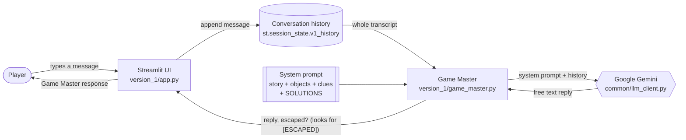

# Architecture - Version 1 (Interactive AI Escape Room)

## Diagram

## How it works

1. The player types a message in the Streamlit chat box.
2. The app adds it to the conversation history held in `st.session_state`.
3. `GameMasterV1.respond()` sends one request to Gemini containing:
   - a **system prompt** built by `build_system_prompt()` from `game_data/forgotten_library.json`.
     It describes the story, all objects and items, the three puzzles, **and the solutions**
     (drawer code, door code and a walkthrough), so that the model can act as referee.
   - the **entire conversation so far** (`history`), which is the model's only memory.
4. Gemini writes the reply. If it decides the player has escaped, it ends the reply with
   the marker `[ESCAPED]`. The app looks for this marker and shows the victory screen.

## Who decides what?

| Decision | Made by |
|---|---|
| Is this object real? | Gemini |
| Does the code / key work? | Gemini |
| What has the player collected? | Gemini (by re-reading the chat) |
| Has the player escaped? | Gemini (`[ESCAPED]` marker) |
| Restart | Python (clears the history) |

Everything that matters for the game's rules lives inside the language model. Python only
moves text between the UI and the API.

## Strengths and limitations

- **Strengths:** very little code, natural conversation, flexible wording, easy to change the story.
- **Limitations** (tested in [testing.md](testing.md)):
  - The model can **forget** earlier actions as the conversation grows.
  - It can **invent** objects, items or clues that are not in the room (hallucination).
  - The solutions are in the prompt, so a player can try to **talk the model into revealing them**.
  - It can **accept invalid actions**, such as using an item that was never collected.
  - It can **contradict** itself, because nothing outside the model records the true state.
  - Victory is decided by a text marker the model writes, so a persuaded model can declare victory.
  - Without the API the game cannot run at all.
