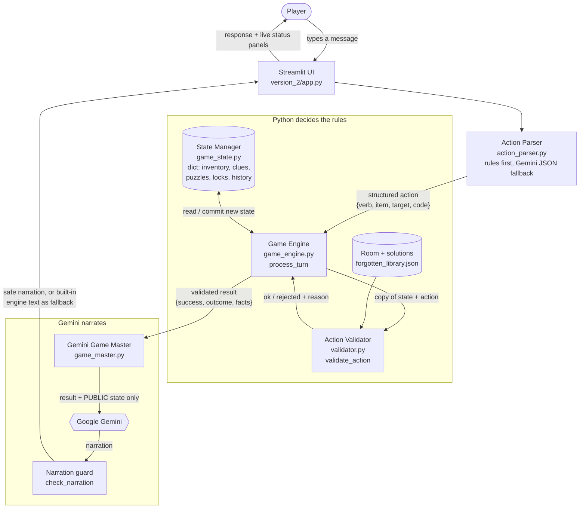

# Architecture - Version 2 (Reliable AI Escape Room)

## Diagram

## How one turn works

1. **Parse.** `parse_action()` turns the sentence into a small dict such as
   `{"verb": "use", "item": "brass_key", "target": "painting"}`.
   A rule-based parser using aliases from the room JSON handles normal play. Only if it
   cannot understand the sentence is Gemini asked to classify it into the same fixed list
   of verbs (JSON output). That answer is checked field by field, and anything malformed
   becomes `"unknown"`.
2. **Validate.** `process_turn()` copies the state and calls `validate_action()`. The
   validator checks, in plain Python: does the object exist and has the player found it?
   Is the item in the inventory? Is the code four digits and correct? Are all three trials
   complete before the door will accept a code?
3. **Apply.** Only if validation passes does the matching engine function
   (`examine_object`, `collect_item`, `use_item`, `open_drawer`, `attempt_door_unlock`, ...)
   change the copied state. The app then stores the new state. A failed action changes
   nothing except the turn counter, the history log and the wrong-code counter.
4. **Narrate.** `GameMasterV2.narrate()` sends Gemini the player's words (as quoted data),
   the engine's result and a **public view** of the state. The public view contains no
   codes or solutions. Gemini writes 2-4 atmospheric sentences.
5. **Guard.** `check_narration()` rejects the text if it contains a code the player has
   not earned, or announces a victory the engine did not confirm. In that case, or if
   the API fails, the engine's own deterministic text is shown instead.

## Who decides what?

| Decision | Version 1 | Version 2 |
|---|---|---|
| Is this object real? | Gemini | `validator.py` (room JSON) |
| Does the code / key work? | Gemini | `validator.py` |
| What has the player collected? | Gemini (chat memory) | `state["inventory"]` |
| Which puzzles are solved? | Gemini (chat memory) | `state["puzzles"]` |
| Has the player escaped? | Gemini (`[ESCAPED]` marker) | `state["escaped"]`, set only by `attempt_door_unlock()` |
| Wording of the response | Gemini | Gemini (or built-in text as fallback) |
| Where solutions are stored | In the LLM prompt | Only in Python / JSON |

## Design principles

- **The picture follows the state:** the room illustration above the chat
  (`common/room_scene.py`) is drawn from `scene_view(state)`, so the drawer, the crimson
  books, the portrait, the brass plate and the door only change when Python has changed the state.

- **Single source of truth:** the state dictionary. The UI panels (inventory, clues,
  trials, door status) are drawn from it, not from the chat.
- **The LLM has no write access:** nothing Gemini returns is ever written into the state.
  Even a fooled parser can only produce an ordinary action, which is still validated.
- **Least knowledge:** the narrator never sees the solutions, so it cannot leak them.
- **Graceful degradation:** with no key, an invalid key, rate limits or timeouts, the game
  stays fully playable with the engine's built-in descriptions.

## What still works without the Gemini API

| Feature | Without API |
|---|---|
| Parsing normal commands (rule-based) | Works |
| Parsing unusual phrasings (Gemini fallback) | Answers "not understood" and suggests commands |
| Validation, inventory, puzzles, escape | Works (pure Python) |
| Narration | Built-in descriptions from the room JSON |
| Hints | Works (deterministic) |
